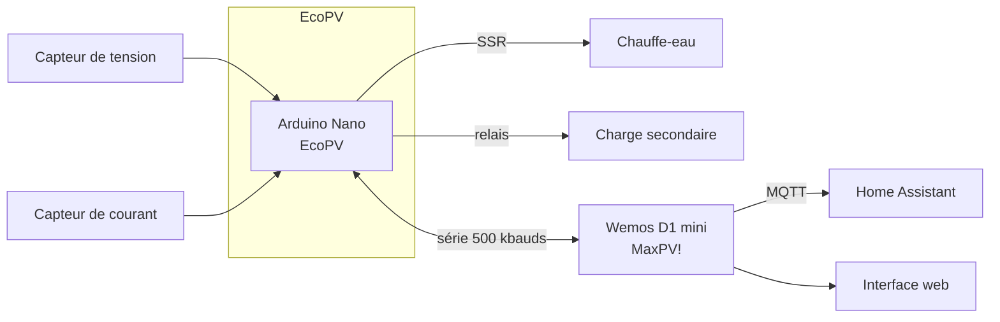

# MaxPV!

**Routeur solaire EcoPV piloté depuis Home Assistant**

## Qu'est-ce que c'est

MaxPV! dirige le surplus de production photovoltaïque vers un chauffe-eau (résistance pilotée par un SSR) plutôt que de l'injecter sur le réseau. Il s'appuie sur le routeur [EcoPV](https://github.com/Jetblack31/EcoPV) (Arduino Nano, qui mesure et route) et sur un Wemos D1 mini (ESP8266, qui fournit le Wifi, MQTT et l'interface web). Tout reste chez vous : rien ne passe par le cloud.

> [!WARNING]
> Les programmes et les schémas proposés ont une vocation informative et pédagogique. Ils ont été testés avec succès par les auteurs, qui déclinent toute responsabilité quant au fonctionnement et aux conséquences de leur utilisation. Intervenir sur des circuits électriques (230 V) est dangereux : faites appel à une personne qualifiée et respectez strictement les normes de sécurité en vigueur.

<!--  -->

## Fonctionnalités

**Routage**
- Même qualité de routage du surplus que EcoPV.
- SSR et relais secondaire de délestage en AUTO, FORCE ou STOP.
- BOOST sur SSR (durée et puissance réglables) ; limite de température avec une sonde 1-Wire.

**Home Assistant**
- MQTT avec autodiscovery complète : 59 entités (mesures, énergie, modes, paramètres, diagnostics, boutons).
- Blueprints : BOOST programmé, RelayPlus, relais miroir.

<!--  -->

**Interface web**
- Une page à 5 onglets (Pico CSS, sans ressource externe) : état, routeur, réseau, étalonnage, système.
- Assistant d'étalonnage, sauvegarde et restauration de la configuration, mise à jour OTA.

**Fiabilité**
- WatchDog Wifi et watchdog MQTT.
- DHCP par défaut (IP fixe optionnelle).

## Architecture

## Démarrage rapide

Détail de chaque étape dans [docs/installation.md](docs/installation.md).

1. **Matériel** : réalisez la carte ([schémas](SchemasMaxPV/)).
2. **Nano** : téléversez [`EcoPV3/EcoPV3.ino`](EcoPV3/EcoPV3.ino) avec l'IDE Arduino.
3. **Wemos** : flashez [`MaxPV_full.bin`](https://github.com/gaetanars/MaxPV/releases/latest/download/MaxPV_full.bin) à l'adresse `0x0`.
4. **Wifi** : connectez-vous au réseau **MaxPV** et choisissez votre Wifi dans le portail captif.
5. **MQTT** : ouvrez <http://maxpv.local/>, onglet **Réseau**, saisissez l'hôte du broker ; l'appareil apparaît dans Home Assistant.

> [!IMPORTANT]
> **Vous venez de la 3.x ?** La 4.0.0 est une rupture (API, historique, FTP, NTP et relais distant retirés). Reflashez le Nano (EcoPV 3.6.1) et le Wemos : voir [la migration](docs/installation.md#migration-depuis-la-3x).

## Documentation

| Document | Contenu |
|---|---|
| [Installation](docs/installation.md) | Pré-requis, flash, premier démarrage, mises à jour, migration, compilation |
| [Home Assistant](docs/home-assistant.md) | Topics MQTT, entités, énergie, blueprints |
| [Fonctionnement](docs/fonctionnement.md) | Interface web, modes, BOOST, watchdogs, pins du Nano |
| [Schémas](SchemasMaxPV/) | Cartes électroniques et composants |
| [CHANGELOG](CHANGELOG.md) | Historique des versions |
| [ROADMAP](docs/ROADMAP.md) | Audit et suivi des correctifs |

## Communauté

- Forum photovoltaïque, discussion sur MaxPV : <https://forum-photovoltaique.fr/viewtopic.php?f=110&t=55244>
- Discussion sur EcoPV : <https://forum-photovoltaique.fr/viewtopic.php?f=110&t=42721>
- Réalisation d'un PCB : <https://forum-photovoltaique.fr/viewtopic.php?f=110&t=42874>
- Montage du PCB : <https://forum-photovoltaique.fr/viewtopic.php?f=110&t=43197>

## Crédits et licence

- Le code de MaxPV! est distribué sous licence LGPL 2.1+ ; il est issu de [Jetblack31/MaxPV](https://github.com/Jetblack31/MaxPV) (Bernard Legrand / Jetblack31) et d'[EcoPV](https://github.com/Jetblack31/EcoPV), dont l'attribution est conservée. Merci à Breizh13 pour les schémas de la carte et aux contributeurs du forum.
- Le firmware du Wemos embarque ElegantOTA (AGPL-3.0) : les binaires distribués sont de ce fait soumis à l'AGPL-3.0.
- L'interface embarque [Pico CSS](https://picocss.com) 2.1.1 (MIT), copie exacte de `@picocss/pico@2.1.1/css/pico.min.css`. SHA-256 de `MaxPV3/data/pico.min.css` : `fbc9a63fc9fc9f72d12fd7fc9806e11fa9f77ae4f9cad146b27003a1119ba3db`.
