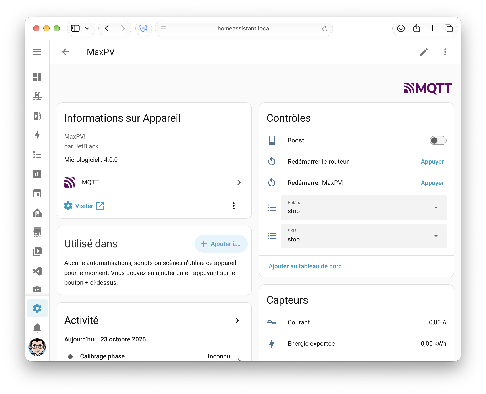

# Home Assistant

MaxPV! publie en MQTT avec autodiscovery (préfixe `homeassistant`). Renseignez l'hôte du broker dans l'onglet **Réseau** de l'interface web : l'appareil MaxPV apparaît ensuite dans Home Assistant.

<!--  -->

## Topics

`<id>` = `maxpv` + identifiant de la puce ESP (visible dans l'onglet Réseau). Base : `maxpv/<id>`.

| Topic | Contenu |
|---|---|
| `maxpv/<id>/status` | Disponibilité `online`/`offline` (retain, LWT). |
| `maxpv/<id>/state` | JSON retain de l'état (mesures, index, modes, états, diagnostics), publié toutes les `mqtt_period` secondes et après chaque commande de mode ou de BOOST. |
| `maxpv/<id>/params` | JSON retain des 16 paramètres EcoPV et des réglages ESP. |
| `maxpv/<id>/<clé>/set` | Commandes. |

Commandes : `triac_mode` et `relay_mode` (`stop`/`force`/`auto`), `boost` (`ON`/`OFF`), une clé par paramètre, et les boutons `restartesp`, `resetecopv`, `savecfg`, `loadcfg`, `saveindx`, `indx0` avec le payload `PRESS`. Une valeur hors bornes est rejetée. Le formatage de l'EEPROM et l'effacement de la configuration ne sont jamais acceptés en MQTT.

## Entités (59)

Les 18 identifiants uniques historiques sont conservés : Home Assistant garde les entités et leur historique.

| Type | Entités |
|---|---|
| Capteurs de mesure (10) | `Tension`, `Courant`, `PuissanceApparente`, `FacteurPuissance`, `PuissanceActive`, `PuissanceRoutee`, `PuissanceImportee`, `PuissanceExportee`, `PuissanceProduite`, `Temperature` |
| Capteurs d'énergie (5) | `EnergieRoutee`, `EnergieImportee`, `EnergieExportee`, `EnergieProduite`, `TempsFonctionnementRelais` |
| Diagnostics (12) | `RSSI`, `Uptime`, `VersionEcoPV`, puis désactivés par défaut : `MemoireLibre`, `RaisonReset`, `DelayMin`, `DelayAvg`, `DelayMax`, `BiasOffset`, `StatusByte`, `OnTime`, `Samples` |
| Capteurs binaires (2) | `EtatRelais`, `ContactRouteur` |
| Selects (2) | `SSR`, `Relais` (stop / force / auto) |
| Switchs (2) | `Boost`, `LimiteTemperature` |
| Numbers (20) | les 16 paramètres EcoPV (`V_CALIB`, `P_CALIB`, `PHASE_CALIB`, `P_OFFSET`, `P_RESISTANCE`, `P_MARGIN`, `GAIN_P`, `GAIN_I`, `E_RESERVE`, `P_DIV2_ACTIVE`, `P_DIV2_IDLE`, `T_DIV2_ON`, `T_DIV2_OFF`, `T_DIV2_TC`, `CNT_CALIB`, `P_INSTALLPV`), `BoostDuree`, `BoostRatio`, `TempMax`, `PeriodeMQTT` |
| Boutons (6) | `RedemarrerESP`, `RedemarrerRouteur`, `SauverParametres`, `RechargerParametres`, `SauverIndex`, `RAZIndex` (désactivé par défaut) |

## Sauvegarde des paramètres

Les paramètres modifiés depuis Home Assistant sont appliqués immédiatement au Nano, mais ne survivent à une coupure qu'après avoir pressé **SauverParametres**.

## Énergie et index journaliers

Les index journaliers et l'historique ne sont plus calculés par le Wemos. Utilisez des `utility_meter` sur les capteurs d'énergie, et le dashboard Énergie de Home Assistant.

<!--  -->

## Blueprints

Dans [`blueprints/automation/maxpv/`](../blueprints/automation/maxpv/) :

| Blueprint | Rôle | Import |
|---|---|---|
| `boost_programme.yaml` | BOOST à heure fixe, jours au choix | [](https://my.home-assistant.io/redirect/blueprint_import/?blueprint_url=https%3A%2F%2Fgithub.com%2Fgaetanars%2FMaxPV%2Fblob%2Fmain%2Fblueprints%2Fautomation%2Fmaxpv%2Fboost_programme.yaml) |
| `relayplus.yaml` | Durées min et max du relais (capteur `history_stats` décrit dans le blueprint) | [](https://my.home-assistant.io/redirect/blueprint_import/?blueprint_url=https%3A%2F%2Fgithub.com%2Fgaetanars%2FMaxPV%2Fblob%2Fmain%2Fblueprints%2Fautomation%2Fmaxpv%2Frelayplus.yaml) |
| `relais_miroir.yaml` | Recopie de l'état du relais sur un interrupteur distant | [](https://my.home-assistant.io/redirect/blueprint_import/?blueprint_url=https%3A%2F%2Fgithub.com%2Fgaetanars%2FMaxPV%2Fblob%2Fmain%2Fblueprints%2Fautomation%2Fmaxpv%2Frelais_miroir.yaml) |

Import manuel : Paramètres > Automatisations > Blueprints > Importer un blueprint, avec l'URL GitHub du fichier.

## Purge des anciens topics retain

Après une migration depuis la 3.x, les anciens messages retain restent sur le broker. Pour les purger, un topic à la fois :

```
mosquitto_pub -r -n -t maxpv/vrms
```

À répéter pour chaque ancien topic (`maxpv/vrms` … `maxpv/temperature`, `maxpv/state`, `maxpv/SYS/<sous-topic>`).
