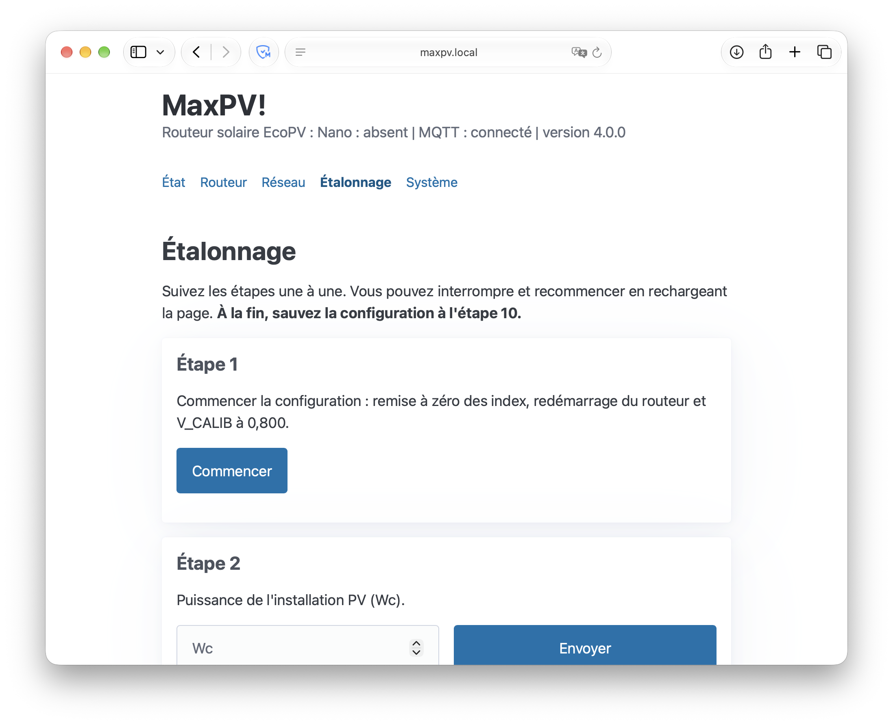

# Installation

## Pré-requis

L'installation se fait par USB : Arduino Nano d'abord, puis Wemos/ESP8266.

- Nano : IDE Arduino 2.x (ou arduino-cli) avec le paquet *Arduino AVR Boards*, bibliothèques OneWire et DallasTemperature (et SSD1306Ascii pour l'écran oLed).
- Wemos : un câble USB (pilote CH340 si le port n'apparaît pas), et soit Chrome/Edge (page esptool-js, rien à installer), soit [esptool](https://github.com/espressif/esptool) (Python).
- Réseau local en Wifi (adresse IP attribuée par DHCP par défaut). Pendant l'installation, un ordinateur ou un téléphone doit pouvoir se connecter temporairement au Wifi du Wemos.

## Matériel

Schémas électroniques et liste des composants : [`SchemasMaxPV/`](../SchemasMaxPV/). Pour la réalisation du montage, voir les fils de discussion du forum dans le [README](../README.md#communauté).

## Programmation de l'Arduino Nano

> [!WARNING]
> Si vous migrez un système EcoPV existant, notez les paramètres du routeur : ils sont effacés et doivent être ressaisis à la fin de l'installation.

1. Ouvrez [`EcoPV3/EcoPV3.ino`](../EcoPV3/EcoPV3.ino) dans l'IDE Arduino configuré pour la carte « Arduino Nano » et le processeur « ATmega328P » (ou « ATmega328P (Old Bootloader) » si le téléversement échoue, fréquent sur les clones).
2. Installez le cas échéant les bibliothèques OneWire et DallasTemperature.
3. Écran oLed : dé-commentez la ligne 47 et vérifiez que SSD1306Ascii est installée.
4. Pour que l'énergie délivrée en modes FORCE et BOOST ne soit pas comptée dans l'index d'énergie routée, modifiez la ligne 65.
5. Les modes par défaut du SSR et du relais à la mise sous tension se règlent aux lignes 118 et 120.
6. Téléversez le programme dans le Nano.

Équivalent en ligne de commande avec [arduino-cli](https://arduino.github.io/arduino-cli/) (remplacez le port par celui de votre Nano ; pour un clone à l'ancien bootloader, utilisez `arduino:avr:nano:cpu=atmega328old`) :

```
arduino-cli core install arduino:avr
arduino-cli lib install OneWire DallasTemperature SSD1306Ascii
arduino-cli compile --fqbn arduino:avr:nano:cpu=atmega328 EcoPV3
arduino-cli upload --fqbn arduino:avr:nano:cpu=atmega328 -p /dev/ttyUSB0 EcoPV3
```

## Programmation du Wemos

1. Téléchargez l'image complète (firmware + filesystem) : <https://github.com/gaetanars/MaxPV/releases/latest/download/MaxPV_full.bin>
2. Branchez le Wemos en USB.
3. Avec esptool-js : ouvrez <https://espressif.github.io/esptool-js/> dans Chrome ou Edge, **Connect**, choisissez le port, **Erase Flash**, puis **Flash Address** `0x0` avec `MaxPV_full.bin` et **Program**.
4. Ou en ligne de commande (esptool 5.x) :

   ```
   esptool --chip esp8266 write-flash --erase-all 0x0 MaxPV_full.bin
   ```

5. Redémarrez le Wemos et connectez-vous au réseau Wifi **MaxPV** qu'il crée. Un portail captif s'ouvre ; sinon, allez sur <http://192.168.4.1>.

   

6. Choisissez votre réseau Wifi et saisissez son mot de passe : le portail ne gère que le Wifi. Le réseau (DHCP par défaut, IP fixe optionnelle) et MQTT se règlent ensuite dans l'interface web.
7. Réinstallez le Nano et le Wemos sur la carte du routeur.

## Premier démarrage

1. Vérifiez que votre ordinateur ou téléphone est sur votre réseau local.
2. Ouvrez <http://maxpv.local/> (ou l'adresse IP du Wemos). L'en-tête indique l'état du Nano (routeur), de MQTT et la version.
3. Onglet **Étalonnage** : l'assistant guide les nouveaux utilisateurs. Sinon, saisissez les paramètres un par un dans l'onglet **Routeur**.

   <!--  -->

4. Deux paramètres sont apparus avec la 3.5 : **P_INSTALLPV** (puissance de l'installation en Wc) et **CNT_CALIB** (poids en Wh des impulsions du compteur de production).
5. Onglet **Réseau** : saisissez l'hôte du broker MQTT (vide = MQTT désactivé), puis enregistrez : le Wemos redémarre.
6. Dans Home Assistant, l'appareil MaxPV apparaît par autodiscovery ([guide](home-assistant.md)). Utilisez **SauverParametres** (ou l'onglet Routeur) pour enregistrer les paramètres dans l'EEPROM du Nano.

## Mises à jour

- **Nano** : par USB, comme ci-dessus.
- **Wemos** : en OTA par Wifi, via le lien **Update** (`/update`) de l'onglet Système. Ordre à suivre : **firmware puis filesystem**. Utilisez les fichiers `MaxPV_firmware.bin` puis `MaxPV_filesystem.bin` de la [dernière release](https://github.com/gaetanars/MaxPV/releases/latest).
- La mise à jour du filesystem efface la configuration Wifi : reconfigurez-la via le réseau **MaxPV** (portail à 192.168.4.1). Faites avant une sauvegarde de la configuration (onglet Système).
- En cas d'échec, reprenez « Programmation du Wemos » (efface toute la configuration du Wemos).

Un ESP 4.0.0 reste compatible avec un Nano en 3.60, mais reflasher le Nano en 3.6.1 est recommandé (corrections du BOOST et de `P_CALIB`).

## Migration depuis la 3.x

La 4.0.0 est une rupture.

**Retirés** : historique et graphiques, index journaliers, BOOST programmé, RelayPlus (remplacés par des [blueprints](home-assistant.md#blueprints)), relais distant (blueprint `relais_miroir`), FTP, NTP, `logMqtt` et `maxpv/SYS/*`, API `/api/*` et `/DLconfig`, pages web multiples.

- Configuration : l'IP fixe d'une config 3.x est conservée (si la passerelle, le masque ou le DNS1 sont invalides : DHCP). Les clés inconnues sont ignorées. L'activation de MQTT dépend uniquement de la présence d'un hôte MQTT. Le port HTTP est fixe (80).
- Anciens topics : `maxpv/vrms` … `maxpv/temperature`, `maxpv/state` et `maxpv/SYS/*` ne sont plus publiés, mais leurs messages retain restent sur le broker ([purge](home-assistant.md#purge-des-anciens-topics-retain)).
- Reflashez le Nano en 3.6.1, puis le Wemos (firmware puis filesystem, ou `MaxPV_full.bin`).

## Compilation avec PlatformIO

Pour une installation personnalisée (sources du Wemos dans [`MaxPV3/`](../MaxPV3/)) :

```
pio run -e d1_mini                      # firmware -> .pio/build/d1_mini/MaxPV<ver>_firmware.bin
pio run --target buildfs -e d1_mini    # image LittleFS depuis MaxPV3/data -> MaxPV<ver>_filesystem.bin
pio run -e d1_mini -t upload / uploadfs
pio test -e native                      # tests natifs sur l'hôte
```

Le firmware du Nano se compile aussi avec `pio ci EcoPV3/EcoPV3.ino --project-conf ci/ecopv.ini -e nano`, mais se flashe via l'IDE Arduino.
